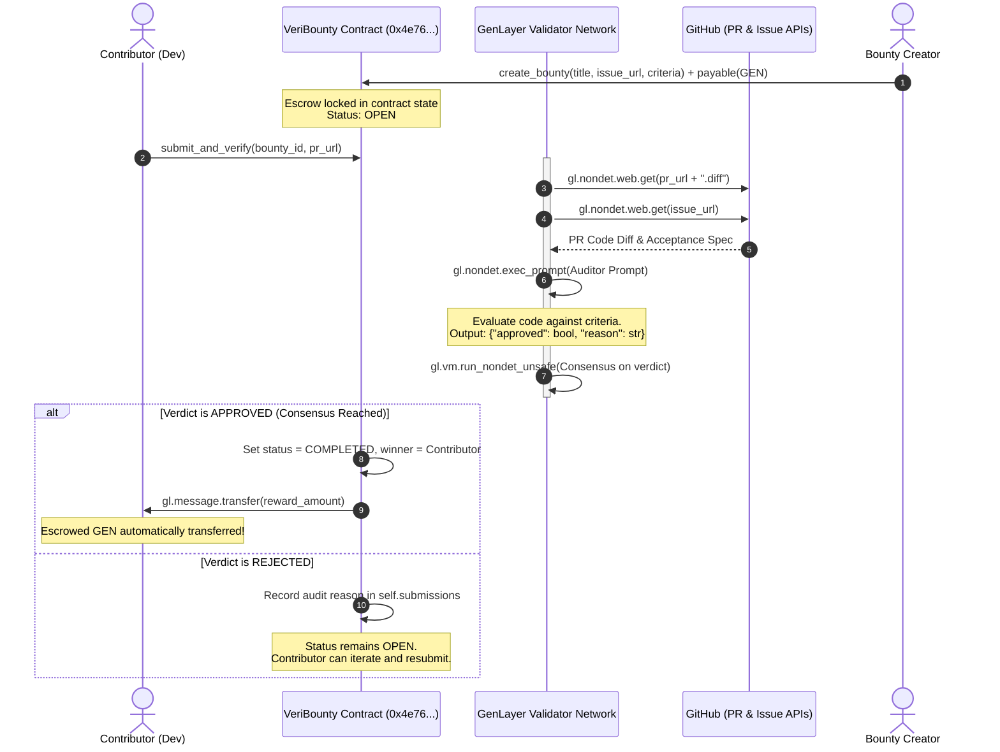

# VeriBounty 🛡️🤖

> **AI-Adjudicated Open-Source & Task Escrow** powered by GenLayer Intelligent Contracts and Optimistic Democracy.

VeriBounty is a decentralized, trustless bounty and escrow platform where open-source issues, task specifications, and code deliverables are autonomously validated by GenLayer's multi-validator AI consensus. When a contributor submits a Pull Request or deliverable URL, GenLayer validators independently fetch the public diff and PR contents using non-deterministic web access (`gl.nondet.web.get`), evaluate the implementation against natural-language acceptance criteria using an integrated LLM (`gl.nondet.exec_prompt`), achieve consensus via the Equivalence Principle, and automatically release escrowed native GEN rewards directly to the contributor's wallet.

---

## 🌟 Key Architectural Pillars

1. **Autonomous Escrow Settlement:**
   - Bounty creators lock native GEN tokens directly into the GenVM Intelligent Contract upon creation.
   - Escrow funds are held deterministically on-chain and cannot be claimed without validator consensus or canceled once submissions are in flight.

2. **Non-Deterministic Web & Diff Ingestion:**
   - GenLayer validators fetch live GitHub Pull Request content, raw `.diff` patches, and GitHub Issue specifications via `gl.nondet.web.get`.
   - Automated token-safe truncation and delimiter-isolated prompts guard against prompt injection while preserving core diff changes.

3. **Multi-Validator AI Consensus (Equivalence Principle):**
   - Independent validators execute an auditor prompt via `gl.nondet.exec_prompt`.
   - The contract enforces comparative consensus over the boolean adjudication verdict (`approved: true | false`) and technical rationale before state updates or token transfers occur.

4. **Zero Mocks & Live Studionet Deployment:**
   - Tested in GenLayer direct mode with 100% pass rate.
   - Deployed and finalized on GenLayer **Studionet** with active seeded bounties and live RPC queries.

---

## 📡 Live Deployments & Network Details

| Parameter | Value |
| :--- | :--- |
| **Live Production Web App** | [https://veribounty.vercel.app](https://veribounty.vercel.app) |
| **GitHub Repository** | [https://github.com/JimmyOgb/veribounty](https://github.com/JimmyOgb/veribounty) |
| **Network** | GenLayer Studionet |
| **Chain ID** | `61999` (`0xf22f`) |
| **RPC Endpoint** | `https://studio.genlayer.com/api` |
| **Explorer** | [GenLayer Explorer](https://genlayer-explorer.vercel.app) |
| **Contract Address** | [`0x4e7689f4CB926c60016E760cBBBF98578a093F52`](https://genlayer-explorer.vercel.app/address/0x4e7689f4CB926c60016E760cBBBF98578a093F52) |
| **Deployment Tx Hash** | [`0x5f0406557a94e4a8044e2a3d3e3f6e88a33eddd9c609a9a4f8b954927dd8ae6f`](https://genlayer-explorer.vercel.app/tx/0x5f0406557a94e4a8044e2a3d3e3f6e88a33eddd9c609a9a4f8b954927dd8ae6f) |
| **Consensus Result** | `ACCEPTED` / `decided` (Validators: `AGREE`) |
| **Deployer Address** | `0xE4220c4b71877bb94EB173f467ef5c5557017085` |

---

## 🔍 How GenLayer Optimistic Democracy Works in VeriBounty



---

## 📂 Repository Structure

```
veribounty/
├── contracts/
│   └── veribounty.py           # GenLayer Intelligent Contract (GenVM pinned runner)
├── tests/
│   └── test_veribounty.py      # Comprehensive direct mode test suite (5/5 passed)
├── scripts/
│   └── seed_veribounty.py      # On-chain seeding script for Studionet bounties
├── frontend/                   # Next.js 15+ App Router Web Application
│   ├── src/
│   │   ├── app/                # App layout and main bounty board
│   │   ├── components/         # Modals, drawers, and live consensus tracker
│   │   ├── lib/                # genlayer-js SDK client, chain config, contracts
│   │   └── types/              # TypeScript definitions for Bounties & Submissions
│   ├── .env.example            # Public environment variable template
│   └── package.json
└── README.md
```

---

## 🧪 Testing the Intelligent Contract

VeriBounty has been validated with GenVM static linting and direct mode unit tests.

### 1. GenVM Static Linting
```bash
genvm-lint check contracts/veribounty.py
```
*Result: 0 errors, 3 AST checks passed, 7 public methods validated.*

### 2. Direct Mode Test Suite
```bash
pytest tests/test_veribounty.py -v
```
Tests cover:
- Bounty creation and payable escrow locking.
- Rejection of insufficient PR diffs with stored audit rationales and retained escrow.
- Approval of complete implementations with automatic escrow balance payout.
- Prevention of duplicate claims on completed bounties.
- Unauthorized cancellation rejection and legitimate creator cancellations.

---

## 💻 Frontend Development Setup

The frontend is built with Next.js 15, TypeScript, Tailwind CSS, and `genlayer-js`.

### 1. Install Dependencies
```bash
cd frontend
npm install
```

### 2. Configure Environment Variables
Copy `.env.example` to `.env.local`:
```bash
NEXT_PUBLIC_CONTRACT_ADDRESS="0x4e7689f4CB926c60016E760cBBBF98578a093F52"
NEXT_PUBLIC_GENLAYER_NETWORK="studionet"
NEXT_PUBLIC_GENLAYER_RPC_URL="https://studio.genlayer.com/api"
NEXT_PUBLIC_GENLAYER_CHAIN_ID="61999"
NEXT_PUBLIC_EXPLORER_URL="https://genlayer-explorer.vercel.app"
```

### 3. Run the Development Server
```bash
npm run dev
```
Open [http://localhost:3000](http://localhost:3000) to view the application.

---

## 📜 License
MIT License. Built for the GenLayer Ecosystem.
